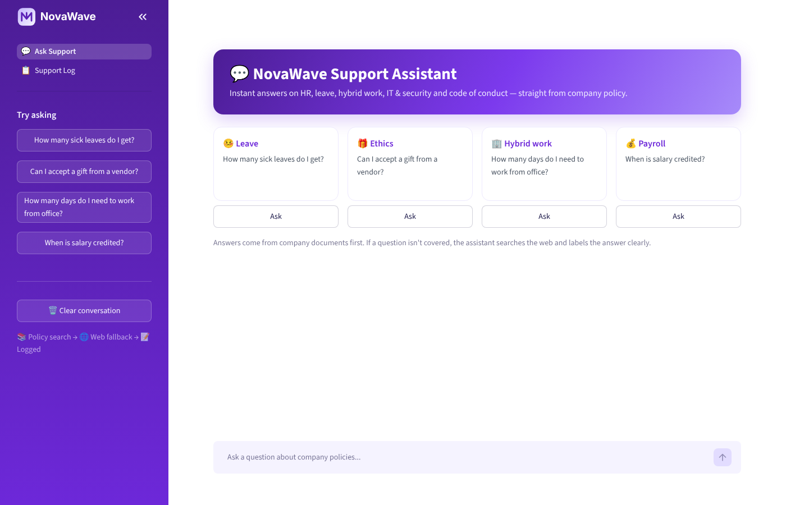
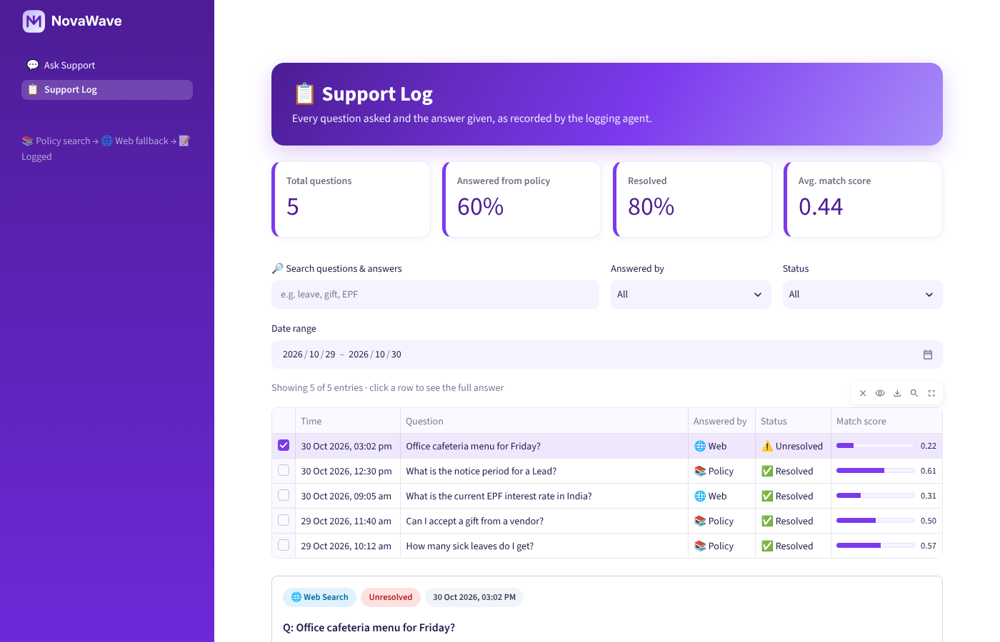

# 💜 CrewAI Customer Support Agent

A multi-agent customer support assistant built with **crewAI**. It answers employee questions from company policy documents using a **FAISS** vector database, falls back to **web search** when the documents don't have the answer, and **logs every question and answer** through a dedicated logging agent. It includes a violet-themed **Streamlit** app with a chat page and a searchable support log dashboard.

> The company (*NovaWave Technologies*) and all its policy documents are fictional sample data created for this project.



---

## ✨ Features

- **3 cooperating agents** in a crewAI sequential crew
  - 📚 **Agent 1 – Knowledge Base Specialist:** semantic search over company documents (FAISS + OpenAI embeddings) with a custom tool
  - 🌐 **Agent 2 – Web Research Specialist:** runs **only** when Agent 1 isn't satisfied (`ConditionalTask`), using Serper web search
  - 📝 **Agent 3 – Interaction Logger:** writes every Q&A to a log file through a custom `LogWriterTool`
- **Structured outputs** (`output_pydantic`), so the hand-off decision uses a real boolean, not text matching
- **Confidence threshold** on cosine similarity decides when the knowledge base "doesn't know"
- **Streamlit app:** chat with source badges, plus a Support Log dashboard with metrics, filters, a full-answer view and CSV export

## 🏗️ Architecture

```
                 ┌──────────────────────────────┐
  Question ────► │ Agent 1: Knowledge Base      │──► FAISS (company docs)
                 │ output: KnowledgeBaseAnswer  │
                 └──────────────┬───────────────┘
                     is_satisfied?
                 ┌──── yes ─────┴───── no ─────┐
                 │                             ▼
                 │              ┌──────────────────────────────┐
                 │              │ Agent 2: Web Search          │──► Serper API
                 │              │ (ConditionalTask)            │
                 │              └──────────────┬───────────────┘
                 ▼                             ▼
                 ┌──────────────────────────────┐
                 │ Agent 3: Logger              │──► logs/support_log.txt
                 │ tool: LogWriterTool          │
                 └──────────────────────────────┘
```

## 📁 Project structure

```
├── app.py                    # Streamlit entry point (2 pages)
├── main.py                   # answer_question() – runs the crew (CLI + used by the UI)
├── agents.py                 # the 3 agents
├── tasks.py                  # tasks + ConditionalTask routing
├── models.py                 # Pydantic output models
├── build_index.py            # chunk -> embed -> save FAISS index
├── tools/
│   ├── vector_search_tool.py # custom FAISS search tool (Agent 1)
│   └── log_writer_tool.py    # custom log file tool (Agent 3)
├── ui/
│   ├── chat_page.py          # 💬 Ask Support
│   ├── logs_page.py          # 📋 Support Log table
│   ├── log_parser.py         # parses the text log into a DataFrame
│   ├── styles.py             # violet theme CSS
│   └── logo.svg
├── data/company_docs/        # 7 sample policy documents (markdown)
├── test_agent1.py            # test Agent 1 alone
├── test_agent2.py            # test Agent 1 + Agent 2
├── .streamlit/config.toml    # theme
└── .env.example
```

## 🚀 Getting started

**Prerequisites:** Python 3.10–3.13, an [OpenAI API key](https://platform.openai.com/api-keys) and a [Serper API key](https://serper.dev).

```bash
# 1. Clone and create a virtual environment
git clone https://github.com/<your-username>/crewai-rag-support-agent.git
cd crewai-rag-support-agent
python -m venv venv
# Windows: venv\Scripts\activate     macOS/Linux: source venv/bin/activate

# 2. Install dependencies
pip install -r requirements.txt

# 3. Add your API keys
cp .env.example .env        # Windows: copy .env.example .env
# then edit .env

# 4. Build the vector index (creates vector_store/)
python build_index.py
python build_index.py --test "How many sick leaves do I get?"

# 5. Run the app
streamlit run app.py
```

### Command-line usage

```bash
python main.py                                    # interactive chat in the terminal
python main.py "Can I accept a gift from a vendor?"
python test_agent1.py                             # Agent 1 only
python test_agent2.py                             # Agent 1 + web fallback
```

## ⚙️ Configuration

| Variable | Default | Purpose |
|---|---|---|
| `OPENAI_MODEL_NAME` | `gpt-4o-mini` | LLM used by all agents |
| `MIN_SIMILARITY_SCORE` | `0.40` | Below this cosine score, Agent 1 is "not satisfied" and Agent 2 runs |
| `TOP_K` | `4` | Number of chunks returned per search |
| `LOG_FILE` | `logs/support_log.txt` | Where Agent 3 writes the log |
| `CREW_VERBOSE` | `false` | Show agent reasoning in the terminal |

**Tuning the threshold:** run `python build_index.py --test "<question>"` with one question the documents answer and one they don't, then set `MIN_SIMILARITY_SCORE` between the two scores.

## 📋 Support log

Every interaction is recorded like this:

```
[2026-10-30 16:34:11]
QUESTION    : about sick leaves
ANSWERED BY : Knowledge Base (Agent 1)
STATUS      : RESOLVED
CONFIDENCE  : 0.566
SOURCES     : 03_leave_policy.md > 5. Sick Leave (SL)
ANSWER      : ...
----------------------------------------------------------------------
```



## 🛠️ Tech stack

crewAI · crewai-tools (SerperDevTool) · FAISS · OpenAI (`gpt-4o-mini`, `text-embedding-3-small`) · Pydantic · Streamlit · pandas

## 🗺️ Roadmap

- [ ] Agent 2 reads full pages (`ScrapeWebsiteTool`) and cross-checks sources to avoid outdated answers
- [ ] Cleaner, conversational answers from Agent 1
- [ ] Login / role-based access for the Support Log page
- [ ] Store logs in SQLite instead of a text file
- [ ] Docker image for deployment
